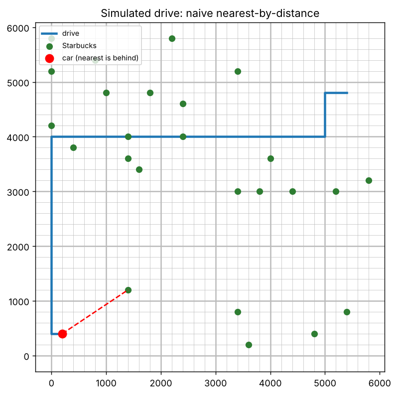
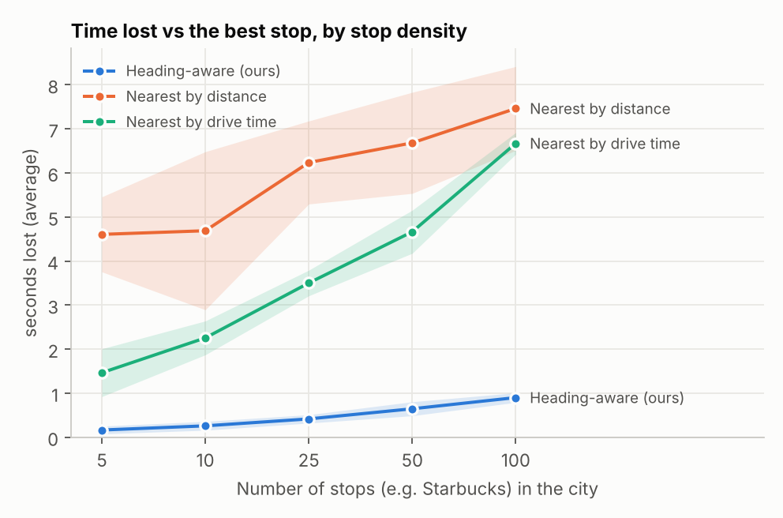
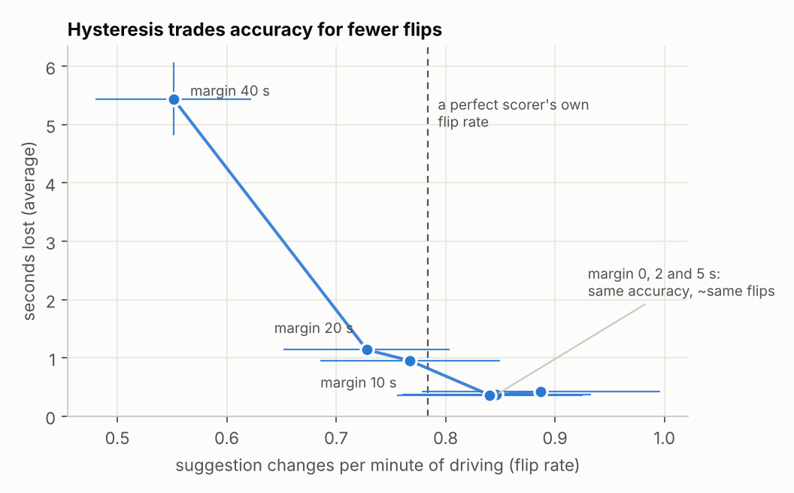
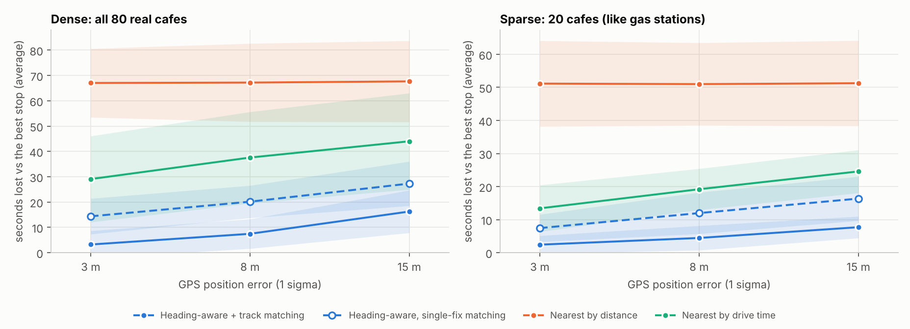

# Detour: heading-aware "nearest stop" suggestions

Feature request filed with Google Maps Platform: https://issuetracker.google.com/issues/587838277

When you ask a map for "the nearest Starbucks" while already driving, the answer is usually ranked by
how close each place is *right now*. It ignores which way you are heading, so it can suggest a place
you just passed. This project asks: **how much does it matter, and can a small amount of code fix it?**

It is a self-contained, reproducible study: a simulator, a ground-truth model, three ranking
strategies, a benchmark with confidence intervals, and runs on real OpenStreetMap streets.



## The idea

Rank candidate stops by the time it would **really** take to reach them *given the direction of travel*:

1. **Map-match** the noisy GPS fix (position + heading) to a directed street segment. A track-aware
   matcher only considers segments the car could have reached from where it was a moment ago.
2. Compute a **direction-aware cost-to-go** to every candidate over the road network: one-way streets
   are respected, and any reversal costs a U-turn penalty and is only possible at intersections.
3. Suggest the stop with the lowest ETA.

## How it is evaluated

- **Ground truth:** the exact heading-aware ETA from the car's true position (30 s U-turn penalty).
  The "oracle" row in the tables is the best any scorer could do.
- **Scorers see only a noisy fix** (default 8 m position / 10 degree heading error), never the true
  street, and they assume a different U-turn penalty (20 s) than the truth (30 s).
- **Metrics:** average seconds lost versus the best stop, share of searches where the pick is the best
  stop, avoidable U-turn suggestions, and suggestion flips per minute.
- **Statistics:** several random seeds, 95% confidence intervals (Student t).
- Compared against: **nearest by straight-line distance** (the behaviour that motivated this) and
  **nearest by drive time** (road-aware but heading-blind).

## Results

### Synthetic grid city (about 18,000 simulated searches)

| Scorer | Avg time lost | Picks the best stop | Avoidable U-turn |
|---|---|---|---|
| Nearest by distance | 6.0 s | 75% | 9.6% |
| Nearest by drive time | 3.6 s | 82% | 12.7% |
| **Heading-aware** | **0.4 s** | **95%** | **3.5%** |
| Oracle | 0 s | 100% | 0% |

Sensitivity sweeps (4 seeds each):

| | |
|---|---|
|  |  |
| Robust to GPS error up to about 15 m; at 40 m it still beats nearest-by-distance by about 3.5x and nearest-by-drive-time by 2x. | A wrong guess of the U-turn cost is fine: the worst of 18 cells (3.9 s) still beats nearest-by-distance (6.2 s). |
|  |  |
| The gap holds from 5 to 100 stops. | **Negative result:** hysteresis (sticking with the current suggestion) does not reduce flips without making picks worse. Most flipping is real, because the best stop genuinely changes as you drive. |

### Real streets (OpenStreetMap)


| Place and category | Nearest by distance | Heading-aware + track matching |
|---|---|---|
| San Francisco, Starbucks (36) | 3.9 s | 0.1 s |
| San Francisco, gas stations (20) | 3.9 s | 0.1 s |
| San Francisco, cafes (47 sampled) | 4.2 s | 0.2 s |
| Helsinki core, cafes (80) | 67.2 s | 7.4 s |
| Helsinki core, cafes (20 sampled) | 51.0 s | 4.4 s |



What the real-road runs show:

- **The improvement is consistent but its size depends on the city.** In San Francisco's regular grid
  nearest-by-distance loses about 4 s per search on average. In Helsinki's dense, one-way-heavy core
  it loses about a minute. The heading-aware scorer removes most of the loss in both.
- **Single-fix map matching is the weak point on real streets.** With zero GPS noise the scorer loses
  exactly 0.0 s, but on dense one-way streets a single noisy fix is easily mis-snapped. The track-aware
  matcher cuts the loss by 2 to 3x (Helsinki, 8 m noise: 20.1 s down to 7.4 s).
- **Fast roads matter more.** In San Francisco, nearest-by-distance loses 5.2 s while the car is on
  roads of 60 km/h or more, versus 2.3 s on slower streets (`analysis_road_class.py`).


*This single example was picked as a large gap to illustrate the mechanism. The averages above are the honest numbers.*

## Limitations (read these before quoting any number)

- **Drives are simulated, not real GPS traces.** Noise is Gaussian. Real GPS error is correlated and
  worst in urban canyons.
- **The ground truth shares its structure with the scorer** (the same direction-aware cost model), so
  a good score is partly expected. The independent checks are the noisy observations, the mismatched
  U-turn penalty, and the real street geometry, but a real-world study would need real traces and
  real driver behaviour.
- **Simple travel-time model:** default speeds per road class, no traffic, signals, turn bans or
  turn costs, and straight segments between OSM nodes.
- **Small, old extracts.** The San Francisco file is an old snapshot (its metadata suggests around 2010-2011); Helsinki covers
  about 1 x 1.6 km. Run `fetch_osm.py` to use current data for your own area.
- **POIs are real OSM nodes** (Starbucks, fuel, cafes) but only those tagged in the snapshot.
- **I did not measure Google Maps itself.** The motivating behaviour is a user observation. Nothing
  here claims how Google's ranking actually works.

## Reproduce

```bash
pip install -e ".[dev]"
pytest -q            # 30 tests
./reproduce.sh       # rebuilds every number and figure (~5 min on 2 cores)
```

### Use your own area

```bash
python3 fetch_osm.py --lat 37.7749 --lon -122.4194 --radius 2500 --out data/mine.osm.gz
python3 run_real.py --osm data/mine.osm.gz --tag "name=~Starbucks" --name Starbucks --min-dist 1500
python3 run_real.py --osm data/mine.osm.gz --tag "amenity=fuel" --name "Gas station" --min-dist 1500
```

`--tag` takes `key=value`, or `key=~text` for a case-insensitive substring match.

## Layout

```
detour/            world.py (directed road network, direction-aware routing), osm.py (OSM loader),
                   matching.py (single-fix + track-aware), scorers.py, truth.py, evaluate.py, ...
run_*.py           benchmarks (grid, sweeps, real roads)      make_*.py   figures
fetch_osm.py       download an area from OpenStreetMap        tools/      PBF -> OSM XML
docs/              feature request draft for the Google Maps Platform Issue Tracker
```

## License and data

Code: MIT. Map data: (c) OpenStreetMap contributors, ODbL; see `data/README.md` for the source of each extract.
