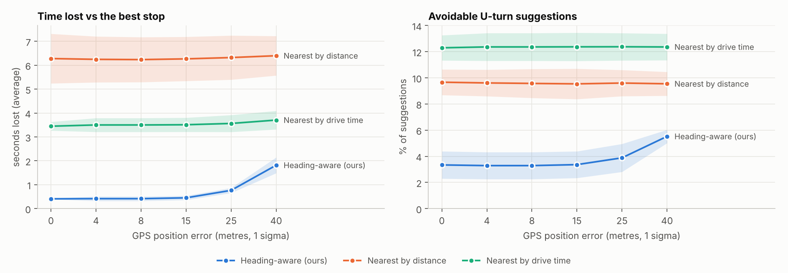
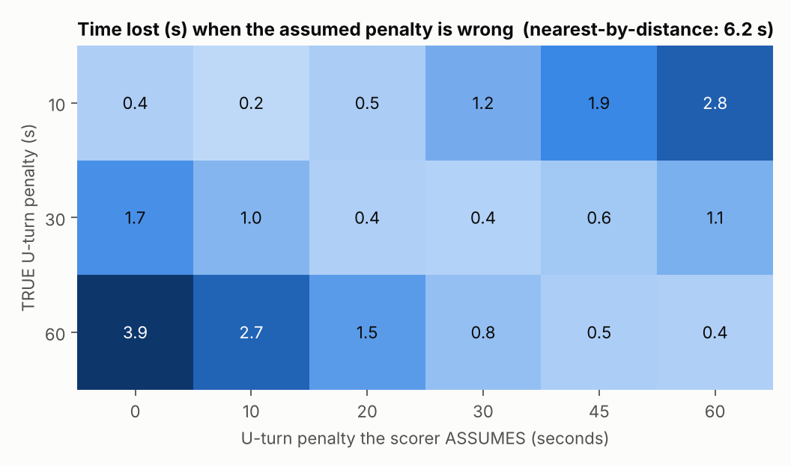
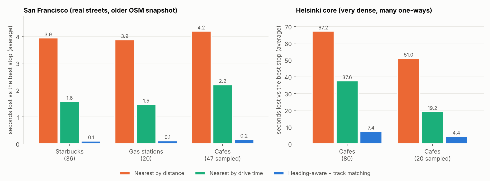
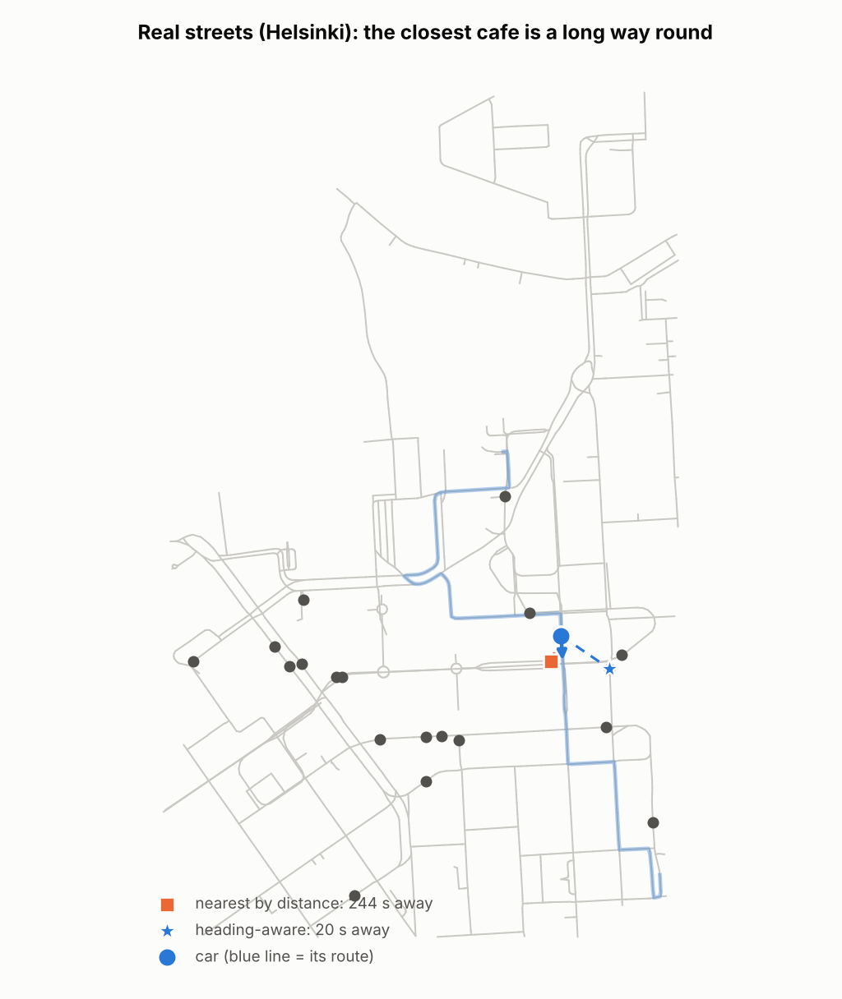

# Detour: heading-aware "nearest stop" suggestions

Feature request filed with Google Maps Platform: https://issuetracker.google.com/issues/587838277

Algorithm specification for implementers (pseudocode, complexity, test vectors): [docs/algorithm.md](docs/algorithm.md)

When you ask a map for "the nearest Starbucks" while already driving, the answer is usually ranked by
how close each place is *right now*. It ignores which way you are heading, so it can suggest a place
you just passed. This project asks: **how much does it matter, and can a small amount of code fix it?**

It is a self-contained, reproducible study: a simulator, a ground-truth model, three ranking
strategies, a benchmark with confidence intervals, and runs on real OpenStreetMap streets.


## The idea

Rank candidate stops by the time it would **really** take to reach them *given the direction of travel*:

1. **Map-match** the noisy GPS fix (position + heading) to a directed street segment. A track-aware
   matcher only considers segments the car could have reached from where it was a moment ago.
2. Compute a **direction-aware cost-to-go** to every candidate over the road network: one-way streets
   are respected, and any reversal costs a U-turn penalty and is only possible at intersections.
3. Suggest the stop with the lowest ETA.

## How it is evaluated

- **Ground truth:** the exact heading-aware ETA from the car's true position (30 s U-turn penalty).
  The "oracle" row in the tables is the best any scorer could do.
- **Scorers see only a noisy fix** (default 8 m position / 10 degree heading error), never the true
  street, and they assume a different U-turn penalty (20 s) than the truth (30 s).
- **Metrics:** average seconds lost versus the best stop, share of searches where the pick is the best
  stop, avoidable U-turn suggestions, and suggestion flips per minute.
- **Statistics:** several random seeds, 95% confidence intervals (Student t).
- Compared against: **nearest by straight-line distance** (the behaviour that motivated this) and
  **nearest by drive time** (road-aware but heading-blind).

## Results

### Synthetic grid city (about 18,000 simulated searches)

| Scorer | Avg time lost | Picks the best stop | Avoidable U-turn |
|---|---|---|---|
| Nearest by distance | 6.0 s | 75% | 9.6% |
| Nearest by drive time | 3.6 s | 82% | 12.7% |
| **Heading-aware** | **0.4 s** | **95%** | **3.5%** |
| Oracle | 0 s | 100% | 0% |

Sensitivity sweeps (4 seeds each):

| | |
|---|---|
|  |  |
| Robust to GPS error up to about 15 m; at 40 m it still beats nearest-by-distance by about 3.5x and nearest-by-drive-time by 2x. | A wrong guess of the U-turn cost is fine: the worst of 18 cells (3.9 s) still beats nearest-by-distance (6.2 s). |
|  |  |
| The gap holds from 5 to 100 stops. | **Negative result:** hysteresis (sticking with the current suggestion) does not reduce flips without making picks worse. Most flipping is real, because the best stop genuinely changes as you drive. |

### Real streets (OpenStreetMap)



| Place and category | Nearest by distance | Heading-aware + track matching |
|---|---|---|
| San Francisco, Starbucks (36) | 3.9 s | 0.1 s |
| San Francisco, gas stations (20) | 3.9 s | 0.1 s |
| San Francisco, cafes (47 sampled) | 4.2 s | 0.2 s |
| Helsinki core, cafes (80) | 67.2 s | 7.4 s |
| Helsinki core, cafes (20 sampled) | 51.0 s | 4.4 s |


What the real-road runs show:

- **The improvement is consistent but its size depends on the city.** In San Francisco's regular grid
  nearest-by-distance loses about 4 s per search on average. In Helsinki's dense, one-way-heavy core
  it loses about a minute. The heading-aware scorer removes most of the loss in both.
- **Single-fix map matching is the weak point on real streets.** With zero GPS noise the scorer loses
  exactly 0.0 s, but on dense one-way streets a single noisy fix is easily mis-snapped. The track-aware
  matcher cuts the loss by 2 to 3x (Helsinki, 8 m noise: 20.1 s down to 7.4 s).
- **Fast roads matter more.** In San Francisco, nearest-by-distance loses 5.2 s while the car is on
  roads of 60 km/h or more, versus 2.3 s on slower streets (`analysis_road_class.py`).



*This single example was picked as a large gap to illustrate the mechanism. The averages above are the honest numbers.*

## Limitations (read these before quoting any number)

- **Drives are simulated, not real GPS traces.** Noise is Gaussian. Real GPS error is correlated and
  worst in urban canyons.
- **The ground truth shares its structure with the scorer** (the same direction-aware cost model), so
  a good score is partly expected. The independent checks are the noisy observations, the mismatched
  U-turn penalty, and the real street geometry, but a real-world study would need real traces and
  real driver behaviour.
- **Simple travel-time model:** default speeds per road class, no traffic, signals, turn bans or
  turn costs, and straight segments between OSM nodes.
- **Small, old extracts.** The San Francisco file is an old snapshot (its metadata suggests around 2010-2011); Helsinki covers
  about 1 x 1.6 km. Run `fetch_osm.py` to use current data for your own area.
- **POIs are real OSM nodes** (Starbucks, fuel, cafes) but only those tagged in the snapshot.
- **I did not measure Google Maps itself.** The motivating behaviour is a user observation. Nothing
  here claims how Google's ranking actually works.

## Reproduce

```bash
pip install -e ".[dev]"
pytest -q            # 33 tests (+24 parity tests when the optional C++ core is built)
./reproduce.sh       # rebuilds every number and figure (~5 min on 2 cores)
```

### Use your own area

```bash
python3 fetch_osm.py --lat 37.7749 --lon -122.4194 --radius 2500 --out data/mine.osm.gz
python3 run_real.py --osm data/mine.osm.gz --tag "name=~Starbucks" --name Starbucks --min-dist 1500
python3 run_real.py --osm data/mine.osm.gz --tag "amenity=fuel" --name "Gas station" --min-dist 1500
```

`--tag` takes `key=value`, or `key=~text` for a case-insensitive substring match.

## C++ core (optional)

The hot routine, `RoadNetwork.cost_to_go` (the backward Dijkstra over directed-edge states described in
`docs/algorithm.md`), has an optional C++17 implementation bound with pybind11 (`cpp/ctg.cpp`,
`detour/native.py`). It is a drop-in speedup: same inputs, same `{(u, v): (seconds, has_uturn)}` result,
same per-target caching. The simulator, OSM loading, map matching, scoring and plotting stay in Python.
If the extension is not built, the pure-Python code runs and nothing else changes.

### Build

```bash
pip install -e ".[native]"        # builds the extension if a C++17 compiler is available (+ numpy)
python3 -c "from detour import native; print(native.enabled())"   # True = the C++ path is active
```

You need a C++17 compiler (g++ or clang; on macOS run `xcode-select --install`). pybind11 is fetched
automatically at build time and numpy is needed at run time. Without a compiler the install still succeeds
and detour uses the Python code. Switches:

| Setting | Effect |
|---|---|
| `DETOUR_NATIVE=0` (environment, at run time) | force the pure-Python `cost_to_go` |
| `net.use_native = False` | same, for one network |
| `DETOUR_NO_NATIVE=1` (at install time) | do not build the extension |
| `DETOUR_REQUIRE_NATIVE=1` (at install time) | make a failed extension build an error (used in CI) |

The C++ path steps aside automatically (the Python code runs) for graphs it does not model identically:
parallel edges, zero speed, non-finite travel times.

### Parity with the Python code

The aim is identical results, not just close ones. `tests/test_native_parity.py` (skipped when the
extension is not built) compares the C++ and Python `cost_to_go` on every reachable state and checks that the
same states are reachable. Seconds are compared with `rel_tol=1e-9`; `has_uturn` flags are checked
separately so a flag difference cannot hide behind matching seconds.

- **What is compared:** the three vectors in `docs/algorithm.md`, `GridWorld(30)` with several target seeds,
  and the real extracts in `data/` (West Oakland, San Francisco, Helsinki), with U-turn penalties 20 s
  (scorer) and 30 s (ground truth). In total 594 `cost_to_go` calls, 2,301,352 states.
- **Result:** on Linux x86_64, seconds are bit-identical on all 2,301,352 states (not merely within
  tolerance), the reachable states are identical, and there are no `has_uturn` flag differences. The same tests
  pass on Apple Silicon and in CI on Ubuntu and macOS.
- **Ties:** the flag depends on which of two equal-cost routes settles first. The C++ copies the Python
  tie-breaking (predecessor order, strict `<`, heap counter order). With penalties 20 s and 30 s exact ties
  between a reversal route and a non-reversal route almost never occur, so a separate test uses penalties
  of 0, 12 and 24 s on the grid, where they are common. Breaking the tie-breaking in the C++ on purpose
  (`<=` instead of `<`, or reversed predecessor order) makes that test fail on `has_uturn` flag
  mismatches (hundreds on the first target it checks) while seconds still match, so the test does detect
  the problem.
- **End to end:** `HeadingAware` scores and picks are identical on the same noisy observation streams with
  the C++ path on and off (542 query points over the grid and the three extracts), and a full Helsinki
  `run_real` evaluation returns identical metrics. No published number changes.

### Timings

Measured with `bench_native.py` on one machine: Apple M2 (8 cores), macOS 26.3.1 (arm64), Python 3.10.18,
numpy 2.2.6. Medians; Python and C++ runs interleaved; caches cold. Raw data is in
`results/bench_native.json`. **Timings depend on your machine: run `python3 bench_native.py` to get yours.**

`cost_to_go`, one target, uncached, U-turn penalty 20 s (median of 9 repetitions):

| Network | Directed edges | Python | C++ search only | C++ incl. conversion to the dict |
|---|---:|---:|---:|---:|
| GridWorld(30) | 3,480 | 6.16 ms | 0.17 ms (36.1x) | 0.71 ms (8.7x) |
| Helsinki | 2,692 | 2.64 ms | 0.13 ms (20.1x) | 0.53 ms (5.0x) |
| San Francisco | 20,606 | 27.8 ms | 1.60 ms (17.4x) | 4.62 ms (6.0x) |

The last column is what `RoadNetwork.cost_to_go` returns, so it is the like-for-like speedup. Building the
native snapshot of a network takes about 2 ms (15 ms for San Francisco) once per network.

Full evaluation (map matching, scoring, ground truth, statistics; median of 5 repetitions):

| Evaluation | Python | With C++ | Speedup |
|---|---:|---:|---:|
| `experiment.run`, GridWorld(30), 20 worlds x 10 drives, 4 scorers | 11.53 s | 5.95 s | 1.9x |
| `experiment.run_real`, Helsinki, 40 drives, 5 scorers | 5.13 s | 4.74 s | about 1.1x |

Only `cost_to_go` is accelerated, so the whole-run gain is limited by how much of the run it was: about 54%
of the Python wall-clock time on the grid, but about 8% on Helsinki, where map matching dominates. The
Helsinki gain is small and noisy: 1.00x to 1.11x across the five repetitions.

An earlier run on a shared 1-vCPU Linux x86_64 machine (Xeon 2.30 GHz, Python 3.12) gave smaller `cost_to_go`
speedups (3.9x to 5.0x including the dict conversion) and 1.8x (grid) and about 1.1x (Helsinki) on the full
evaluations.

Tested locally on macOS (Apple M2, Python 3.10) and on Linux x86_64 (Python 3.10 and 3.12). CI also builds and
tests the extension on Ubuntu and macOS (see `.github/workflows/ci.yml`).

## Layout

```
detour/            world.py (directed road network, direction-aware routing), osm.py (OSM loader),
                   matching.py (single-fix + track-aware), scorers.py, truth.py, evaluate.py, ...
cpp/ctg.cpp        optional C++ cost_to_go, built by setup.py (see "C++ core (optional)")
bench_native.py    times Python vs C++ (writes results/bench_native.json)
run_*.py           benchmarks (grid, sweeps, real roads)      make_*.py   figures
fetch_osm.py       download an area from OpenStreetMap        tools/      PBF -> OSM XML
docs/              feature request draft for the Google Maps Platform Issue Tracker
```

## License and data

Code: MIT. Map data: (c) OpenStreetMap contributors, ODbL; see `data/README.md` for the source of each extract.
